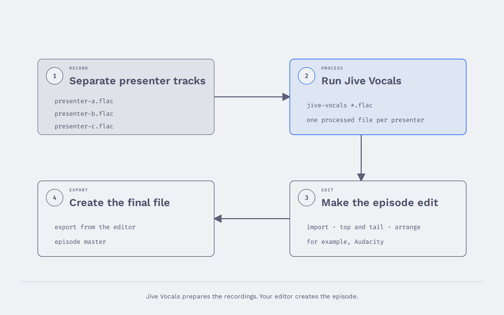
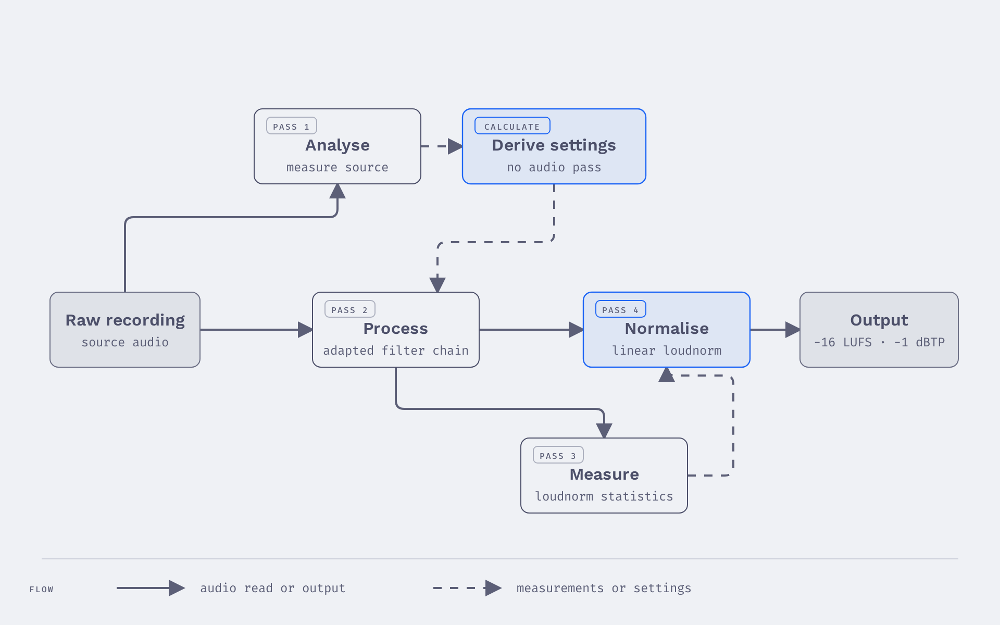
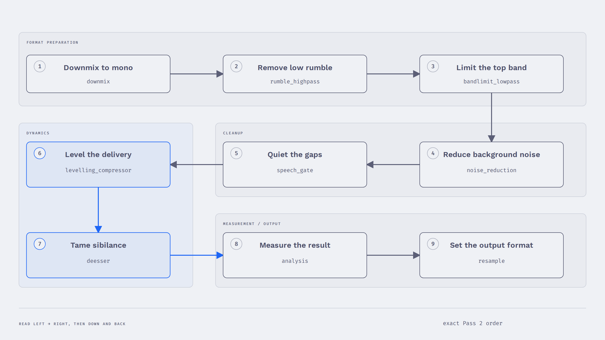

<!-- tailor:social-header:start -->
<p align="center">
  <a href="https://linuxmatters.sh/jive/vocals/"><picture><source media="(prefers-color-scheme: dark)" srcset="pages/social/hero-dark.svg"></picture></a>
</p>
<!-- tailor:social-header:end -->

<!-- tailor:social-links:start -->
<p align="center">
  <a href="https://bsky.app/profile/wimpys.world"><picture><source media="(prefers-color-scheme: dark)" srcset="pages/social/link-bluesky-dark.svg"></picture></a>
  <a href="https://wimpysworld.social/@martin"><picture><source media="(prefers-color-scheme: dark)" srcset="pages/social/link-mastodon-dark.svg"></picture></a>
  <a href="https://linkedin.com/in/martinwimpress"><picture><source media="(prefers-color-scheme: dark)" srcset="pages/social/link-linkedin-dark.svg"></picture></a>
</p>
<!-- tailor:social-links:end -->

<!-- tailor:social-community:start -->
<p align="center">
  <a href="https://discord.com/invite/vUsydfP"><picture><source media="(prefers-color-scheme: dark)" srcset="https://raw.githubusercontent.com/linuxmatters/jive-vocals/social-assets/community-dark.svg"></picture></a>
</p>
<!-- tailor:social-community:end -->

> Formerly known as Jivetalking.

Raw microphone recordings into broadcast-ready audio in one command. No configuration, and no surprises.

Your files emerge at -16 LUFS / -1 dBTP, the loudness standard for spoken-word podcasts, with room rumble, background hiss, clicks, and harsh sibilance sorted automatically. Multiple files process in parallel, each with its own TUI progress row. Everything needed is embedded in the binary. This is not how audio tools usually work, and that is rather the point.

Website: [linuxmatters.sh/jive/vocals](https://linuxmatters.sh/jive/vocals/)

## Features

- **Adaptive four-pass pipeline**: analyses each recording before setting compressor thresholds, noise reduction, speech gate, and de-esser parameters.
- **Automatic spoken-word clean-up**: removes room rumble, background hiss, clicks, and harsh sibilance without manual tuning.
- **Broadcast loudness normalisation**: outputs matched `-16 LUFS` / `-1 dBTP` masters for spoken-word podcasts.
- **Parallel multi-presenter processing**: processes multiple files at once with live terminal progress, filter status panels, and Recording and Processed star ratings.
- **Empirical Markdown reports**: writes every measurement and adapted filter setting beside each output file.
- **Analysis-only and diagnostics modes**: check recordings before committing to a take (`-a`), or emit before/after spectrograms and interval sidecars (`--diagnostics`).
- **Self-contained binary**: embeds static FFmpeg libraries with zero runtime dependencies.

<!-- tailor:social-stats:start -->
<p align="center">
  <a href="https://github.com/linuxmatters/jive-vocals/pulse"><picture><source media="(prefers-color-scheme: dark)" srcset="https://raw.githubusercontent.com/linuxmatters/jive-vocals/social-assets/stats-dark.svg"></picture></a>
</p>
<!-- tailor:social-stats:end -->

## Install

First-party signed package repositories are published for Linux and macOS through [wimpys.world](https://wimpys.world/). Choose your platform below for setup instructions and automatic updates.

<!-- tailor:social-packages:start -->
<p align="center">
  <a href="https://apt.wimpys.world/#jive-vocals"><picture><source media="(prefers-color-scheme: dark)" srcset="pages/social/pkg-apt-dark.svg"></picture></a>
  <a href="https://rpm.wimpys.world/#jive-vocals"><picture><source media="(prefers-color-scheme: dark)" srcset="pages/social/pkg-rpm-dark.svg"></picture></a>
  <a href="https://pkg.wimpys.world/#jive-vocals"><picture><source media="(prefers-color-scheme: dark)" srcset="pages/social/pkg-pkg-dark.svg"></picture></a>
  <br>
  <a href="https://brew.wimpys.world/#jive-vocals"><picture><source media="(prefers-color-scheme: dark)" srcset="pages/social/pkg-brew-dark.svg"></picture></a>
  <a href="https://nix.wimpys.world/#jive-vocals"><picture><source media="(prefers-color-scheme: dark)" srcset="pages/social/pkg-nix-dark.svg"></picture></a>
</p>
<!-- tailor:social-packages:end -->

The Linux packages and binaries need glibc 2.38 or later, for example Ubuntu 24.04, Debian 13, or Fedora 39.

<details>
<summary><strong>Any platform (<code>bin</code>)</strong> - install and update the release binary directly</summary>

[bin](https://github.com/marcosnils/bin) installs and updates the release binary:

```shell
bin install github.com/linuxmatters/jive-vocals
```

</details>

<!-- tailor:social-sponsors:start -->
<p align="center">
  <a href="https://github.com/sponsors/flexiondotorg"><picture><source media="(prefers-color-scheme: dark)" srcset="pages/social/sponsors-dark.svg"></picture></a>
</p>
<!-- tailor:social-sponsors:end -->

## Quick start

Process one or more presenter recordings in a single command:

```bash
jive-vocals LMP-81s-mark.flac LMP-81s-martin.flac LMP-81s-popey.flac
```

<!-- tailor:social-demo:start -->
<p align="center">
  <picture><source media="(prefers-color-scheme: dark)" srcset="pages/social/demo-dark.svg"></picture>
</p>
<!-- tailor:social-demo:end -->

## The Typical Workflow

[](docs/diagrams/creator-workflow.png)

[Open the HTML source](docs/diagrams/creator-workflow.html).

Each presenter records a separate FLAC file. Jive Vocals processes the files to
matched -16 LUFS levels. Import them into Audacity to trim and edit, then export
the finished episode.

## The Four-Pass Pipeline

Jive Vocals analyses each recording before it selects the settings that benefit from measurement. Measured speech RMS sets the compressor threshold, and measured sibilance controls whether the de-esser engages and how strongly it acts. Other filter settings stay fixed where one value is right for spoken word.

[](docs/diagrams/pipeline-overview.png)

[Open the HTML source](docs/diagrams/pipeline-overview.html).

Four passes carry a raw recording to a broadcast-ready master:

1. **Analyse:** measure loudness, noise floor, and speech; detect the room tone.
2. **Process:** run the adapted filter chain.
3. **Measure:** read the processed signal back so normalisation has accurate numbers.
4. **Normalise:** set the final loudness to -16 LUFS / -1 dBTP.

The Pass 2 filter chain has each stage hand the next a cleaner signal:

[](docs/diagrams/pass2-filter-chain.png)

[Open the HTML source](docs/diagrams/pass2-filter-chain.html).

For the full walkthrough, see **[docs/Pipeline.md](docs/Pipeline.md)**: what each stage does, why it sits where it does, how the adaptive tuning works, and how normalisation reaches -16 LUFS honestly, with a diagram.

## Quality Ratings

When a file finishes, the completion box shows two star ratings: **Recording** (your source capture, the one that varies) and **Processed** (the output against the -16 LUFS target, almost always five stars). The pair tells the story: a two-star capture taken to a five-star master.

```
Jive Vocals 🗣️

╭──────────────────────────────────────────╮
│ Processing 3 files, 3 complete, 0 failed │
╰──────────────────────────────────────────╯

 🗸 LMP-83-mark-LUFS-16-processed.flac
╭──────────────────────────────────────────╮
│ Time        02:31  ·  ⚡ 19.0×           │
│ Loudness    -35.2 → -16.1 LUFS  Δ +19.1  │
│ True peak    -6.2 →  -1.7 ㏈TP  Δ  +4.5  │
│ Dynamics     15.0 →  13.3 LU    Δ  -1.7  │
│ Noise floor < -96 ㏈                     │
│ Recording   ★★★★☆  Great                 │
│ Processed   ★★★★★  Excellent             │
╰──────────────────────────────────────────╯
 🗸 LMP-83-martin-LUFS-16-processed.flac
╭──────────────────────────────────────────╮
│ Time        02:38  ·  ⚡ 18.1×           │
│ Loudness    -27.8 → -16.0 LUFS  Δ +11.8  │
│ True peak    -4.5 →  -1.8 ㏈TP  Δ  +2.7  │
│ Dynamics     14.7 →  12.0 LU    Δ  -2.7  │
│ Noise floor -91 ㏈                       │
│ Recording   ★★★★☆  Great                 │
│ Processed   ★★★★★  Excellent             │
╰──────────────────────────────────────────╯
 🗸 LMP-83-popey-LUFS-16-processed.flac
╭──────────────────────────────────────────╮
│ Time        02:43  ·  ⚡ 17.6×           │
│ Loudness    -29.8 → -16.0 LUFS  Δ +13.8  │
│ True peak    -0.1 →  -1.3 ㏈TP  Δ  -1.2  │
│ Dynamics     12.3 →   8.9 LU    Δ  -3.4  │
│ Noise floor -86 ㏈                       │
│ Recording   ★★☆☆☆  Fair                  │
│ Processed   ★★★★★  Excellent             │
╰──────────────────────────────────────────╯
```

See **[docs/Usage.md](docs/Usage.md#quality-ratings)** for the three axes behind the Recording score and what a low star is telling you to fix.

## Usage

```bash
jive-vocals [flags] <files...>
```

### Flags

| Flag | Description |
|------|-------------|
| `-v, --version` | Show version and exit |
| `-a, --analysis-only` | Run analysis only (Pass 1), display results, skip processing |
| `-d, --debug` | Enable debug logging to `jive-vocals-debug.log` |
| `--diagnostics` | Write extra diagnostic artefacts: before/after spectrogram PNGs plus `.intervals.jsonl`/`.candidates.jsonl` sidecars. Adds extra FFmpeg passes. Off by default |

### Examples

```bash
# Process multiple presenters in parallel (worker count tracks file count)
jive-vocals presenter1.flac presenter2.flac presenter3.flac

# Inspect recordings without processing
jive-vocals -a presenter1.flac presenter2.flac

# Debug a problematic recording
jive-vocals -d troublesome-recording.flac

# Process all FLAC files in directory
jive-vocals *.flac

# Emit before/after spectrograms and interval sidecars
jive-vocals --diagnostics presenter1.flac
```

Processing always writes a Markdown report next to each processed output. For example, `recording-LUFS-16-processed.flac` gets `recording-LUFS-16-processed.md`. The report is empirical: every measurement and the exact adapted filter parameters, with objective metric definitions and no quality verdicts. Analysis-only runs write `<input>-analysis.md` instead.

### Diagnostics

`--diagnostics` writes before/after spectrogram PNGs and `.intervals.jsonl` / `.candidates.jsonl` sidecars beside the report, for sweeps and side-by-side comparison. It changes no DSP, so the processed audio is byte-identical with the flag on or off.

See **[docs/Usage.md](docs/Usage.md#diagnostics)** for the spectrogram naming scheme and sidecar formats.

### Analysis-Only Mode

Pass `--analysis-only` to run Pass 1 only. It writes `<input>-analysis.md` next to each input and shows the Recording stars plus a one-line gain verdict on screen, without producing any audio. Useful for checking a capture before you commit to a take.

See **[docs/Usage.md](docs/Usage.md#analysis-only-mode)** for what the report covers and how to read the gain-advice thermometer.

## Development

Requires Go, Nix, and a tolerance for CGO.

```bash
# Enter development shell (FFmpeg dependencies provided)
nix develop

# Initialise submodules and download static FFmpeg libraries
just setup

# Build (never use go build directly - requires CGO + version injection)
just build

# Run tests
just test

# Install to ~/.local/bin
just install
```

The full source layout, architecture, and contribution standards live in [AGENTS.md](AGENTS.md).

### Tailor integration

The root `justfile` imports the managed Tailor commands with Go, CGO, and ffmpeg-statigo enabled in `.tailor.yml`.
Use `just build`, `just test`, and `just lint` for quality checks.
The build also writes the versioned root binary through `just/project/build.sh`, with the existing flags.
Default tests remain hermetic. The optional `testdata/justfile` keeps audio integration tests and manual validation separate.

`just lint` checks without changing source and includes local `govulncheck`. Use `just lint correct` only to tidy modules and format source.
The pinned GitHub Actions SARIF scan and specialised release builds remain unchanged.
The root `release` recipe overrides the generic recipe and keeps unprefixed `X.Y.Z` tags.

Run `just setup` explicitly to update the ffmpeg-statigo submodule and download libraries. Quality commands never run setup.
The Nix shell imports managed packages and hooks with the existing `go_1_26` selection and native dependencies.
`.envrc` watches the Nix fragments and keeps manual reloads. After review, include the new files in Git before normal flake use.
Review and approve `.envrc` through the usual direnv process, then reload the development shell manually.

### Design Documentation

- [Usage Guide](docs/Usage.md): driving Jive Vocals in depth: quality ratings, analysis-only mode, and diagnostics
- [Audio Pipeline](docs/Pipeline.md): how and why the processing pipeline is built and tuned, with a diagram
- [The hardware that taught me](docs/Inspiration.md): the influences and heritage behind Jive Vocals' processing approach
- [Levelator Comparison](docs/Levelator-Comparison-And-Gap-Analysis.md): how Jive Vocals compares to The Levelator, with capabilities and gaps
- [Spectral Metrics Reference](docs/Spectral-Metrics-Reference.md): how measurements drive adaptation
- [Normalisation Tuning](docs/Normalisation-Tuning.md): why the loudnorm and limiter constants hold their corpus-derived values

## Support and contributing

Read [Support](SUPPORT.md) for help and [Contributing](CONTRIBUTING.md) before submitting a change.

<!-- tailor:social-stars:start -->
<p align="center">
  <a href="https://github.com/linuxmatters/jive-vocals/stargazers"><picture><source media="(prefers-color-scheme: dark)" srcset="https://raw.githubusercontent.com/linuxmatters/jive-vocals/social-assets/stars-dark.svg"></picture></a>
</p>
<!-- tailor:social-stars:end -->

<!-- tailor:social-contributors:start -->
<p align="center">
  <a href="https://github.com/linuxmatters/jive-vocals/graphs/contributors"><picture><source media="(prefers-color-scheme: dark)" srcset="https://raw.githubusercontent.com/linuxmatters/jive-vocals/social-assets/contributors-dark.svg"></picture></a>
</p>
<!-- tailor:social-contributors:end -->

<!-- tailor:social-footer:start -->
<p align="center">
  <a href="https://tailor.wimpys.world"><picture><source media="(prefers-color-scheme: dark)" srcset="pages/social/footer-dark.svg"></picture></a>
</p>
<!-- tailor:social-footer:end -->
